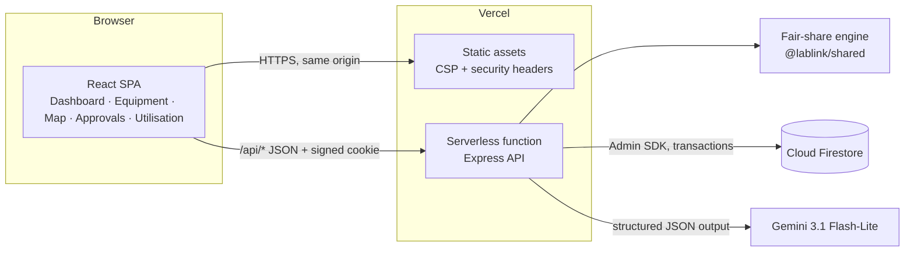

# LabLink — Making College Laboratories More Accessible

[](https://github.com/tramplingh/PromptWars/actions/workflows/ci.yml)

A GenAI-powered campus laboratory resource-sharing platform. Students discover specialised equipment across departments, book slots, request project-based access, and faculty approve requests. When several students want the same equipment at the same time, a **deterministic fair-share engine** recommends an allocation and **Gemini** explains it in plain language.

> **No login pages.** A profile menu in the top bar lets anyone explore the student, faculty and lab-admin experiences instantly. Each choice issues a signed, HttpOnly session cookie, and the server enforces every permission.

## What makes LabLink different

Most lab-booking tools are a calendar with an approve button. LabLink goes after the hard parts of the brief:

1. **AI project planner: from "I have a project" to a complete, feasible schedule.** Describe the project once ("mill the PCB, debug the sensors, laser-cut the frame"). Gemini breaks it into ordered steps; a deterministic scheduler books the best-fitting machine for each step **across departments**, in dependency order, inside lab hours and capacity, around your other bookings, before your deadline, and books it all in one click.
2. **Fairness you can audit.** Contested slots are decided by a transparent, unit-tested scoring engine (deadline, fair share, capability fit, waiting time), not by an LLM. Losers are moved to a reserved fair alternative, and Gemini explains the outcome to faculty and to each student.
3. **No-show release with automatic backfill.** Students check in at the device by scanning a daily rotating QR code on the lab kiosk. Unclaimed sessions are released 15 minutes after the start and handed to the highest-priority queued request; no-shows count against the student's fair share. Booked-but-unused time is the biggest waste in shared labs, and this closes that gap.
4. **A live, explorable campus.** An isometric campus map shows every instrument's real-time status and draws the walking route from your department to the equipment you pick.

## At a glance: evidence per evaluation area

| Area              | Where to look                                                                                                                                                           |
| ----------------- | ----------------------------------------------------------------------------------------------------------------------------------------------------------------------- |
| Problem alignment | Every requirement mapped to a feature in [Approach and Logic](#approach-and-logic); fair-share engine, AI project planner, no-show backfill                             |
| Code quality      | Layered design and decision notes in [docs/ARCHITECTURE.md](docs/ARCHITECTURE.md); enforced complexity and size limits; pure domain package shared by client and server |
| Security          | Signed HttpOnly sessions, server-side authorisation, strict CSP, CSRF guard, rate limits, schema-validated and sanitised LLM output ([Security](#security))             |
| Efficiency        | ~21 KB gzipped landing page, lazy routes, cached Gemini calls, HTTP caching ([Efficiency](#efficiency))                                                                 |
| Testing           | 173 tests, coverage thresholds enforced in CI ([Testing](#testing))                                                                                                     |
| Accessibility     | WAI-ARIA patterns, text equivalents for the map and calendar, axe-core scans in tests ([Accessibility](#accessibility))                                                 |

**60-second demo:** _Dashboard → Project planner → "Final-year drone" example → Book all → My bookings (check in with the kiosk code) → switch to Dr. Kavitha Rao → Approvals → Explain with AI → Apply fair allocation → Campus map → Updates feed shows the no-show release and backfill._

---

## Chosen Vertical

**Education / Campus Operations: shared laboratory resources.**

Colleges own expensive, specialised equipment (GPU workstations, spectrum analyzers, PCR machines, laser cutters) that stays locked inside one department. Students in other departments rarely know it exists, booking happens over WhatsApp or paper registers, and when two students need the same machine before a deadline the outcome is first-come-first-served or whoever knows the lab assistant. LabLink makes equipment **discoverable**, **bookable** and **fairly allocated** across the whole campus.

## Approach and Logic

The core design choice: **AI assists people; it never makes the allocation decision.**

| Problem-statement requirement                    | LabLink feature                                                                                                                                                                                                                                                                                            |
| ------------------------------------------------ | ---------------------------------------------------------------------------------------------------------------------------------------------------------------------------------------------------------------------------------------------------------------------------------------------------------- |
| Discover equipment across departments            | Campus catalogue (grid/table, filters, **live status** per item), a **live SVG campus map** of every building and lab, plus **Gemini natural-language search** ("I need to capture muscle signals" → Biosignal Acquisition Kit, with a reason)                                                             |
| Intelligent slot booking                         | Hour-by-hour availability grid; instant confirmation for free slots; when a slot is taken, the API suggests **the nearest free slot or an equivalent device in another department**                                                                                                                        |
| Project-based access requests                    | Every booking carries a project (title, summary, deadline, required capabilities). The **AI project planner** schedules a whole multi-equipment project in one go; the **Gemini request assistant** turns a rough idea into a clear single request                                                         |
| Faculty approvals                                | Department-scoped approval queue ranked by priority score, with approve/decline and notes                                                                                                                                                                                                                  |
| Resolve scheduling conflicts fairly and feasibly | **Fair-share allocation engine** (below) + one-click "Apply fair allocation" + **Gemini explanation** for faculty and each student                                                                                                                                                                         |
| Optimise resource utilisation                    | **Check-in with no-show release and automatic backfill** (idle booked slots go back to the queue); role dashboards (pipeline KPIs, highest/lowest utilisation, fair-share usage meter), utilisation report (per-equipment usage, demand by hour, idle equipment) + **Gemini optimisation recommendations** |

### The fair-share allocation engine (`packages/shared/src/allocation.ts`)

Overlapping requests for the same equipment that exceed its unit count form a **conflict**. Each contender gets a transparent 0–100 priority score:

| Factor           | Weight | Meaning                                                                                                 |
| ---------------- | ------ | ------------------------------------------------------------------------------------------------------- |
| Deadline urgency | 40%    | Closer project deadline → higher priority (30-day horizon)                                              |
| Fair share       | 25%    | Fewer approved lab hours in the last 14 days → higher priority (stops a few students hogging equipment) |
| Capability fit   | 20%    | Share of the project's required capabilities this device provides                                       |
| Waiting time     | 15%    | Longer wait for a decision → higher priority (saturates at 72h)                                         |

Requests whose slot falls after their own deadline are marked **infeasible** and ranked last. Ties break first-come-first-served, then by id, so results are **fully deterministic**.

The engine then walks the ranking:

1. Feasible requests that still fit the unit capacity **keep their slot**.
2. Everyone else is **reassigned** to the best alternative: first an **equivalent device** (same category, at least the same capability fit) **at the same time**, otherwise the **same device at the nearest free time before their deadline**.
3. Each displaced student's primary alternative is **reserved** in the working calendar, so two students are never offered the same fallback.

Why not let the LLM decide? An LLM allocation can't be reproduced, audited or unit-tested, and it can be swayed by persuasive request text. Here the engine is pure TypeScript with tests; Gemini only explains the result and **cannot change it**.

### The AI project planner (`packages/shared/src/planner.ts`)

1. **Gemini proposes, the engine disposes.** Gemini turns the description into 2–6 steps (title, purpose, capability tags, hours, prerequisites). Its output is sanitised: tags are whitelisted against the catalogue vocabulary, hours are clamped, and dependencies may only point backwards. Without Gemini, a rule-based breakdown maps everyday words to capabilities and orders steps as the student mentioned them.
2. **Feasible scheduling.** Steps are ordered topologically (cycles rejected). For each step, only devices offering its **primary** capability are considered. The scheduler picks the device that finishes the step earliest (instant-booking devices win ties), splits long work into sessions within each device's per-booking limit, and never overlaps the student's own bookings or exceeds capacity. Everything stays before the deadline, with slack reported.
3. **Booking goes through the normal rules.** "Book all" calls the regular booking service for every session (approval, capacity and fairness still apply) and reports per-session outcomes.

### Check-in, no-show release and backfill (`packages/shared/src/checkin.ts`)

- Each device has a **lab kiosk display** with a QR code and a 6-character code: an HMAC of the device and the date, so it rotates daily and can't be guessed. Scanning or typing it proves the student is physically at the device.
- Check-in opens 15 minutes before a session. With no check-in 15 minutes after the start (or 15 minutes after the slot was granted, for walk-ups, late approvals and backfills), the session becomes a **no-show**: the slot is released and the hours still count toward the student's fair share.
- On **instant-booking** equipment, a released slot is **backfilled** automatically with the highest-priority queued request (same scoring engine). Approval-required equipment (e.g. the laser cutter's safety induction) keeps faculty in the loop and is only released.
- Serverless hosting has no background worker, so the sweep runs **lazily** on API reads, throttled and idempotent, inside repository transactions.

## How the Solution Works



**Student flow:** the dashboard shows upcoming bookings, pending decisions, reallocations and a **fair-share usage meter** → search in plain English, filter the catalogue or browse the **campus map** (green = free now) → or plan a whole project in the **Project planner** → open a device → pick a start time on the grid → describe the idea and click **Draft my request** (Gemini) → submit. The server decides the outcome atomically:

- free slot and no approval needed → **confirmed instantly**
- approval-required equipment → **pending** for the faculty in charge
- other students already requested that time → **queued for fair resolution**
- already booked → **409 with alternatives** the student can take in one click

At the lab, the student checks in with the kiosk code (or scans its QR); otherwise the slot is released to the queue.

**Faculty flow:** the dashboard pipeline (Awaiting approval · Conflicts · Live now · Down, split into Today / This week / Older, with urgent flags) and a live **updates feed** / notifications bell lead to the **Approvals** page, which lists conflicts with the engine's recommendation, each student's score breakdown and reasons, and suggested moves. **Explain with AI** produces a summary plus an empathetic message per student. **Apply fair allocation** commits the whole plan: the server recomputes it (it never trusts the client's copy) and re-validates it inside a transaction.

Faculty and admins can open any device's **lab kiosk display** (check-in QR and today's sessions with live check-in / no-show status).

**Admin flow:** **Utilisation** shows campus-wide usage, demand by hour and idle equipment, with Gemini recommendations (e.g. promote idle spectrum analyzers to other departments, stagger peak-hour bookings).

### Google technologies used

| Service                                                                      | How it is used                                                                                                                             | Why it matters                                                                                                                                                                                                                            |
| ---------------------------------------------------------------------------- | ------------------------------------------------------------------------------------------------------------------------------------------ | ----------------------------------------------------------------------------------------------------------------------------------------------------------------------------------------------------------------------------------------- |
| **Gemini 3.1 Flash-Lite** (`@google/genai`, configurable via `GEMINI_MODEL`) | Project breakdown for the planner, natural-language equipment search, request drafting, conflict explanations, utilisation recommendations | Uses **structured JSON output** with a schema, validated again with Zod; responses are grounded in catalogue data; thinking budget 0 for low latency; 8–20 s timeouts; results cached; `/api/health` reports the last success and failure |
| **Cloud Firestore** (Firebase Admin SDK)                                     | Durable booking storage on serverless hosting                                                                                              | Capacity checks run in **Firestore transactions**, so two students can never both win a slot. Only the server accesses Firestore (no client SDK, no public rules surface)                                                                 |
| **Google AI Studio**                                                         | API key provisioning                                                                                                                       | —                                                                                                                                                                                                                                         |

Every Gemini feature has a **deterministic rule-based fallback** (keyword/synonym search, template drafting and explanations, rule-based insights). The UI labels each result **Gemini** or **Smart rules**, so the product stays fully functional, and honest, without an API key.

### Project structure

```
packages/
  shared/   Domain types, Zod schemas, calendar maths, allocation engine, project scheduler, check-in rules (pure, framework-free)
  server/   Express API: routes → services → repositories; Gemini client; Firestore/in-memory storage
  web/      React + Vite + Tailwind SPA: pages/ (route containers), components/<feature>/, lib/ (pure helpers + hooks)
api/        Vercel serverless entry (re-exports the bundled Express app)
docs/       ARCHITECTURE.md: layers, request lifecycle, design decisions, API reference
```

The server follows a layered design: **routes** (HTTP, validation) → **services** (business rules) → **repositories** (storage behind a `BookingRepository` interface with in-memory and Firestore implementations). Dependencies are wired in one composition root (`bootstrap.ts`) and injected, which keeps every layer testable with a fixed clock and a fake LLM. See [docs/ARCHITECTURE.md](docs/ARCHITECTURE.md) for the request lifecycle, design decisions and full API reference.

### Code quality

- **One source of truth for rules:** scoring, allocation, scheduling, check-in and validation live in the framework-free `shared` package, used by the browser (instant feedback) and the server (enforcement).
- **Small, focused modules:** ESLint enforces cyclomatic complexity ≤ 12, nesting depth ≤ 4, ≤ 300 lines per file and ≤ 100 lines per function, and bans non-null assertions and nested ternaries. Pages only compose feature components; derivations live in pure, unit-tested helpers (`web/src/lib`).
- **AI code split by concern:** orchestration (`aiService`), output contracts (`outputSchemas`), prompts, sanitising and deterministic fallbacks are separate modules.
- **Strict TypeScript** everywhere, Prettier formatting, and a CI pipeline (format → lint → typecheck → tests with coverage thresholds → build → `npm audit`).

## Assumptions

- **Identity:** the brief says "no login pages", so demo personas (4 students, 4 faculty, 1 lab admin) replace authentication. A production deployment would map campus SSO identities to the same roles; the authorisation checks would stay unchanged.
- **Authority:** faculty approve requests for equipment in **their own department**; the lab admin can act on all. When a conflict resolution moves a student to an equivalent device in another department, the platform assumes a campus-wide sharing agreement (that is the platform's purpose).
- **Time:** labs open Monday–Friday in whole-hour slots within each lab's opening hours, in a single campus timezone (`CAMPUS_TIMEZONE`, default Asia/Kolkata). Bookings open up to 30 days ahead.
- **Catalogue:** departments, labs, equipment and personas are reference data maintained by lab administrators; they ship as seed data. Bookings are the mutable state and live in Firestore.
- **Demo data:** bookings are generated relative to "today" on start-up, so there are always two live conflicts to resolve (a laser cutter and a pair of GPU workstations) plus a week of realistic usage history.
- **Presence:** a kiosk tablet (or printed daily code) sits beside each device; scanning its code is treated as proof of presence. Backfill auto-approves only on instant-booking equipment; approval-required equipment stays a faculty decision.
- **Planning horizon:** the project planner schedules up to 30 days ahead, starting from the next full hour.
- **Equivalence:** two devices are interchangeable when they share a category and the alternative provides at least the same share of the project's required capabilities.

---

## Security

- **Input validation:** every request body, query and path parameter is validated against shared Zod schemas (bounded lengths and array sizes, strict id patterns), with a 16 KB JSON body limit.
- **Sessions:** stateless HMAC-SHA256 signed tokens (constant-time comparison, 8-hour expiry) in `HttpOnly; SameSite=Strict; Secure` cookies. `SESSION_SECRET` (≥32 chars) is mandatory in production.
- **Authorisation:** role and department checks in the service layer (not just the UI); students can only cancel their own bookings.
- **CSRF:** SameSite=Strict cookies plus a requirement that state-changing requests are `application/json` (else 415).
- **Headers:** Helmet with a strict CSP (`default-src 'self'`, `frame-ancestors 'none'`, no inline scripts) on the API; equivalent CSP, HSTS and other headers for static assets in `vercel.json`.
- **Abuse limits:** rate limiting per client (600 requests per 15 minutes on the API; 20 per minute on Gemini-backed endpoints).
- **LLM safety:** user text is wrapped in delimited `<user_input>` blocks with angle brackets stripped, and the system prompt forbids following embedded instructions. Model output must pass a schema; ids are whitelisted against the catalogue and capability tags against the device. The model never makes decisions, and its output is rendered as plain text (React escaping, no `dangerouslySetInnerHTML`).
- **Check-in codes:** per-device, per-day HMAC codes compared in constant time; check-in requires a student session that owns an approved session in its window.
- **Planner:** model-proposed steps are sanitised before scheduling, and every planned session is re-validated by the normal booking rules when booked.
- **Concurrency safety:** all read-modify-write booking flows run in repository transactions; applying a plan uses optimistic validation and returns `409` if the calendar changed.
- **Errors:** a central handler returns a consistent `{ error: { code, message } }` envelope and never leaks stack traces. Logs contain no prompts or personal text.
- **Dependencies:** `npm audit` reports 0 vulnerabilities; secrets live only in environment variables (`.env` is git-ignored; see `.env.example`).

## Efficiency

- The landing dashboard ships about **21 KB gzipped** of app code (plus a long-cached vendor chunk). Every other page (equipment, map, approvals, utilisation) is lazy-loaded, and Zod loads only on the booking page (`sideEffects: false` tree-shaking).
- The campus map is hand-built inline SVG (no map library or tiles); live status polls once a minute and pauses while the tab is hidden.
- The QR generator only loads with the kiosk page; the no-show sweep is throttled to once per 30 seconds per instance.
- The updates feed is **derived** from booking history on the server (no duplicate event store), and the Inter font is self-hosted (variable weight file, no third-party requests).
- TanStack Query caches server state with targeted invalidation after mutations; reference data is HTTP-cacheable (`Cache-Control` + ETag); hashed assets are immutable for a year.
- Gemini calls are cached (TTL + LRU, keyed by a SHA-256 hash), run with thinking disabled and a hard timeout, and fall back instantly on failure.
- The API reads the campus-wide calendar only when it needs to suggest alternatives, keeps O(1) catalogue lookups, loads firebase-admin lazily, and reuses one Express instance per warm serverless container.
- The allocation engine is pure, works hour by hour over small windows, and is deterministic (cacheable, testable).

## Testing

```bash
npm test               # all workspaces (173 tests)
npm run test:coverage  # with V8 coverage and enforced thresholds
npm run check          # typecheck + lint + tests with coverage (also run in CI)
```

| Package       | What is covered                                                                                                                                                                                                                                                                                                                                                                                                                                                                                                                                                                                                                                                                                                                                                                                                                                        |
| ------------- | ------------------------------------------------------------------------------------------------------------------------------------------------------------------------------------------------------------------------------------------------------------------------------------------------------------------------------------------------------------------------------------------------------------------------------------------------------------------------------------------------------------------------------------------------------------------------------------------------------------------------------------------------------------------------------------------------------------------------------------------------------------------------------------------------------------------------------------------------------ |
| `shared` (41) | Calendar maths, capacity, free-slot search, scoring factors, conflict detection, fair resolution (determinism, no duplicate alternatives, deadline feasibility); **project scheduler** (dependency order, cycles, session splitting, primary capability, deadline, own-booking overlap, determinism); **check-in rules** (window, grace for walk-ups, no-show fair-share penalty)                                                                                                                                                                                                                                                                                                                                                                                                                                                                      |
| `server` (73) | Supertest API integration: **planner** (Gemini and fallback breakdowns, output sanitisation, feasible chains, booking a plan, validation); **check-in** (kiosk codes, wrong/rotated codes, release + backfill, approval-required equipment not auto-approved, backfilled students keep their grace period); AI health reporting; live equipment status (in-use / closed / maintenance), role-scoped activity feed, booking outcomes, validation edge cases, alternatives on 409, double-booking, cancellation ownership, approvals, department scoping, end-to-end conflict resolution; security (CSP, cookie flags, CSRF 415, oversized/malformed bodies, rate limiting, session tampering/expiry); AI service with a fake LLM (hallucinated id filtering, prompt-injection wrapping, caching, fallback on invalid output); transaction serialisation |
| `web` (59)    | Components, pages and end-to-end UI flows with Testing Library: booking a slot (validation → confirmation), approvals (AI explanation, apply fair allocation, decisions with notes), my bookings, utilisation insights; unit tests for catalogue filters, booking validation, activity-feed grouping, planner helpers, focus trapping, persisted preferences and map selection; project planner (steps, gaps, book all), lab kiosk, QR check-in link, campus-geometry unit tests, dashboard, catalogue grid/table + filtering, AI results, campus-map pin labels, profile switching, notifications (Escape returns focus), role-aware navigation, auto-selected profile (no login page), keyboard selection, and **axe-core accessibility scans**                                                                                                      |

Line coverage: **shared 94%**, **server 88%**, **web 87%**. Each package has thresholds in its Vitest config (shared ≥ 90%, server ≥ 85%, web ≥ 85% lines), so a coverage drop fails CI.

## Accessibility

- Semantic landmarks (`header`, `nav`, `main`, `footer`, labelled `search` regions), a **skip link**, breadcrumbs, one `h1` per page, and focus moved to the main content on navigation.
- The mobile navigation drawer is a modal dialog that traps focus, closes on Escape and returns focus to its trigger; popovers (profile, notifications) do the same. Tabs follow the WAI-ARIA tablist pattern with arrow-key navigation.
- Every campus-map pin is a real button labelled with name, lab and live status, and the synced list beside the map is a full text equivalent.
- The availability calendar is a real `<table>` of buttons with descriptive labels ("Tue 24 Nov 10AM: 1 of 2 units available"). State is conveyed in **text, not only colour**, and selections use `aria-pressed`.
- Every form field has a label; validation errors are linked with `aria-describedby` and `aria-invalid`.
- Toasts are announced through an `aria-live` region; score factors are exposed as `role="meter"` with values.
- Visible `:focus-visible` rings, WCAG-friendly colour choices, `prefers-reduced-motion` support, and a responsive layout down to mobile widths.
- Enforced by `eslint-plugin-jsx-a11y` (strict) and axe-core checks in the test suite.

---

## Running locally

Requirements: Node.js 20+.

```bash
npm install
cp .env.example .env     # optional: add GEMINI_API_KEY for live AI
npm run dev              # web on http://localhost:5173, API on :8080
```

Without a Gemini key, the app runs fully on the rule-based fallbacks. Without Firestore it uses the in-memory store with seeded demo data.

## Deploying to Vercel

1. Create a Firebase project (the free Spark plan is enough) and enable **Cloud Firestore**.
2. In _Project settings → Service accounts_, generate a private key, then base64-encode the JSON:
   `base64 -w0 service-account.json` (macOS: `base64 -i service-account.json`).
3. Import the GitHub repo in Vercel (it reads `vercel.json`) and set these environment variables:

| Variable                   | Value                             |
| -------------------------- | --------------------------------- |
| `SESSION_SECRET`           | a random string of 32+ characters |
| `GEMINI_API_KEY`           | key from Google AI Studio         |
| `DATA_BACKEND`             | `firestore`                       |
| `GOOGLE_CLOUD_PROJECT`     | your Firebase project id          |
| `FIREBASE_SERVICE_ACCOUNT` | the base64 string from step 2     |

On the first request, the demo bookings are seeded into an empty `bookings` collection.

> Serverless instances don't share memory, so use `DATA_BACKEND=firestore` on Vercel. The in-memory backend is meant for local development and tests. Rate-limit counters are kept per instance, which is a best-effort limit on serverless.

## Tech stack

React 18 · TypeScript · Vite · Tailwind CSS · TanStack Query · React Router · Express · Zod · Gemini (`@google/genai`) · Cloud Firestore (Firebase Admin) · Vitest · Testing Library · axe-core · ESLint · Vercel
