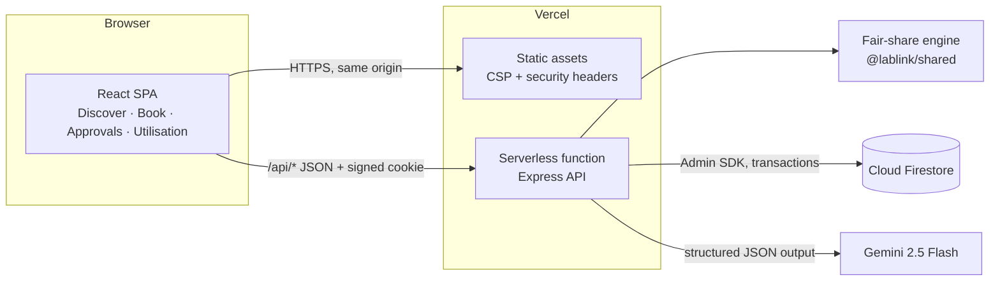

# LabLink — Making College Laboratories More Accessible

A GenAI-powered campus laboratory resource-sharing platform. Students discover specialised equipment across departments, book slots, request project-based access, and faculty approve requests. When several students want the same equipment at the same time, a **deterministic fair-share engine** recommends an allocation and **Gemini** explains it in plain language.

> **No login pages.** A header role switcher lets anyone explore the student, faculty and lab-admin experiences instantly. Each choice issues a signed, HttpOnly session cookie, and the server enforces every permission.

---

## Chosen Vertical

**Education / Campus Operations: shared laboratory resources.**

Colleges own expensive, specialised equipment (GPU workstations, spectrum analyzers, PCR machines, laser cutters) that stays locked inside one department. Students in other departments rarely know it exists, booking happens over WhatsApp or paper registers, and when two students need the same machine before a deadline the outcome is first-come-first-served or whoever knows the lab assistant. LabLink makes equipment **discoverable**, **bookable** and **fairly allocated** across the whole campus.

## Approach and Logic

The core design choice: **AI assists people; it never makes the allocation decision.**

| Problem-statement requirement                    | LabLink feature                                                                                                                                                                     |
| ------------------------------------------------ | ----------------------------------------------------------------------------------------------------------------------------------------------------------------------------------- |
| Discover equipment across departments            | Campus catalogue with filters, plus **Gemini natural-language search** ("I need to capture muscle signals" → Biosignal Acquisition Kit, with a reason)                              |
| Intelligent slot booking                         | Hour-by-hour availability grid; instant confirmation for free slots; when a slot is taken, the API suggests **the nearest free slot or an equivalent device in another department** |
| Project-based access requests                    | Every booking carries a project (title, summary, deadline, required capabilities). The **Gemini request assistant** turns a rough idea into a clear request                         |
| Faculty approvals                                | Department-scoped approval queue ranked by priority score, with approve/decline and notes                                                                                           |
| Resolve scheduling conflicts fairly and feasibly | **Fair-share allocation engine** (below) + one-click "Apply fair allocation" + **Gemini explanation** for faculty and each student                                                  |
| Optimise resource utilisation                    | Utilisation dashboard (per-equipment usage, demand by hour, idle equipment) + **Gemini optimisation recommendations**                                                               |

### The fair-share allocation engine (`packages/shared/src/allocation.ts`)

Overlapping requests for the same equipment that exceed its unit count form a **conflict**. Each contender gets a transparent 0–100 priority score:

| Factor           | Weight | Meaning                                                                                                 |
| ---------------- | ------ | ------------------------------------------------------------------------------------------------------- |
| Deadline urgency | 40%    | Closer project deadline → higher priority (30-day horizon)                                              |
| Fair share       | 25%    | Fewer approved lab hours in the last 14 days → higher priority (stops a few students hogging equipment) |
| Capability fit   | 20%    | Share of the project's required capabilities this device provides                                       |
| Waiting time     | 15%    | Longer wait for a decision → higher priority (saturates at 72h)                                         |

Requests whose slot falls after their own deadline are marked **infeasible** and ranked last. Ties break first-come-first-served, then by id, so results are **fully deterministic**.

The engine then walks the ranking:

1. Feasible requests that still fit the unit capacity **keep their slot**.
2. Everyone else is **reassigned** to the best alternative: first an **equivalent device** (same category, at least the same capability fit) **at the same time**, otherwise the **same device at the nearest free time before their deadline**.
3. Each displaced student's primary alternative is **reserved** in the working calendar, so two students are never offered the same fallback.

Why not let the LLM decide? An LLM allocation can't be reproduced, audited or unit-tested, and it can be swayed by persuasive request text. Here the engine is pure TypeScript with tests; Gemini only explains the result and **cannot change it**.

## How the Solution Works



**Student flow:** pick a profile → search in plain English or filter the catalogue → open a device → pick a start time on the grid → describe the idea and click **Draft my request** (Gemini) → submit. The server decides the outcome atomically:

- free slot and no approval needed → **confirmed instantly**
- approval-required equipment → **pending** for the faculty in charge
- other students already requested that time → **queued for fair resolution**
- already booked → **409 with alternatives** the student can take in one click

**Faculty flow:** the **Approvals** page lists conflicts with the engine's recommendation, each student's score breakdown and reasons, and suggested moves. **Explain with AI** produces a summary plus an empathetic message per student. **Apply fair allocation** commits the whole plan: the server recomputes it (it never trusts the client's copy) and re-validates it inside a transaction.

**Admin flow:** **Utilisation** shows campus-wide usage, demand by hour and idle equipment, with Gemini recommendations (e.g. promote idle spectrum analyzers to other departments, stagger peak-hour bookings).

### Google technologies used

| Service                                  | How it is used                                                                                          | Why it matters                                                                                                                                                                   |
| ---------------------------------------- | ------------------------------------------------------------------------------------------------------- | -------------------------------------------------------------------------------------------------------------------------------------------------------------------------------- |
| **Gemini 2.5 Flash** (`@google/genai`)   | Natural-language equipment search, request drafting, conflict explanations, utilisation recommendations | Uses **structured JSON output** with a schema, validated again with Zod; responses are grounded in catalogue data; thinking budget 0 for low latency; 8s timeout; results cached |
| **Cloud Firestore** (Firebase Admin SDK) | Durable booking storage on serverless hosting                                                           | Capacity checks run in **Firestore transactions**, so two students can never both win a slot. Only the server accesses Firestore (no client SDK, no public rules surface)        |
| **Google AI Studio**                     | API key provisioning                                                                                    | —                                                                                                                                                                                |

Every Gemini feature has a **deterministic rule-based fallback** (keyword/synonym search, template drafting and explanations, rule-based insights). The UI labels each result **Gemini** or **Smart rules**, so the product stays fully functional, and honest, without an API key.

### Project structure

```
packages/
  shared/   Domain types, Zod schemas, calendar maths, allocation engine (pure, framework-free)
  server/   Express API: routes → services → repositories; Gemini client; Firestore/in-memory storage
  web/      React + Vite + Tailwind SPA, TanStack Query, code-split pages
api/        Vercel serverless entry (re-exports the bundled Express app)
```

The server follows a layered design: **routes** (HTTP, validation) → **services** (business rules) → **repositories** (storage behind a `BookingRepository` interface with in-memory and Firestore implementations). Dependencies are wired in one composition root (`bootstrap.ts`) and injected, which keeps every layer testable with a fixed clock and a fake LLM.

## Assumptions

- **Identity:** the brief says "no login pages", so demo personas (4 students, 4 faculty, 1 lab admin) replace authentication. A production deployment would map campus SSO identities to the same roles; the authorisation checks would stay unchanged.
- **Authority:** faculty approve requests for equipment in **their own department**; the lab admin can act on all. When a conflict resolution moves a student to an equivalent device in another department, the platform assumes a campus-wide sharing agreement (that is the platform's purpose).
- **Time:** labs open Monday–Friday in whole-hour slots within each lab's opening hours, in a single campus timezone (`CAMPUS_TIMEZONE`, default Asia/Kolkata). Bookings open up to 30 days ahead.
- **Catalogue:** departments, labs, equipment and personas are reference data maintained by lab administrators; they ship as seed data. Bookings are the mutable state and live in Firestore.
- **Demo data:** bookings are generated relative to "today" on start-up, so there are always two live conflicts to resolve (a laser cutter and a pair of GPU workstations) plus a week of realistic usage history.
- **Equivalence:** two devices are interchangeable when they share a category and the alternative provides at least the same share of the project's required capabilities.

---

## Security

- **Input validation:** every request body, query and path parameter is validated against shared Zod schemas (bounded lengths and array sizes, strict id patterns), with a 16 KB JSON body limit.
- **Sessions:** stateless HMAC-SHA256 signed tokens (constant-time comparison, 8-hour expiry) in `HttpOnly; SameSite=Strict; Secure` cookies. `SESSION_SECRET` (≥32 chars) is mandatory in production.
- **Authorisation:** role and department checks in the service layer (not just the UI); students can only cancel their own bookings.
- **CSRF:** SameSite=Strict cookies plus a requirement that state-changing requests are `application/json` (else 415).
- **Headers:** Helmet with a strict CSP (`default-src 'self'`, `frame-ancestors 'none'`, no inline scripts) on the API; equivalent CSP, HSTS and other headers for static assets in `vercel.json`.
- **Abuse limits:** rate limiting per client (600 requests per 15 minutes on the API; 20 per minute on Gemini-backed endpoints).
- **LLM safety:** user text is wrapped in delimited `<user_input>` blocks with angle brackets stripped, and the system prompt forbids following embedded instructions. Model output must pass a schema; ids are whitelisted against the catalogue and capability tags against the device. The model never makes decisions, and its output is rendered as plain text (React escaping, no `dangerouslySetInnerHTML`).
- **Concurrency safety:** all read-modify-write booking flows run in repository transactions; applying a plan uses optimistic validation and returns `409` if the calendar changed.
- **Errors:** a central handler returns a consistent `{ error: { code, message } }` envelope and never leaks stack traces. Logs contain no prompts or personal text.
- **Dependencies:** `npm audit` reports 0 vulnerabilities; secrets live only in environment variables (`.env` is git-ignored; see `.env.example`).

## Efficiency

- Landing-page JavaScript is about **11 KB gzipped** of app code (plus a long-cached vendor chunk). Secondary pages are lazy-loaded, and Zod loads only on the booking page (`sideEffects: false` tree-shaking).
- TanStack Query caches server state with targeted invalidation after mutations; reference data is HTTP-cacheable (`Cache-Control` + ETag); hashed assets are immutable for a year.
- Gemini calls are cached (TTL + LRU, keyed by a SHA-256 hash), run with thinking disabled and a hard timeout, and fall back instantly on failure.
- The API reads the campus-wide calendar only when it needs to suggest alternatives, keeps O(1) catalogue lookups, loads firebase-admin lazily, and reuses one Express instance per warm serverless container.
- The allocation engine is pure, works hour by hour over small windows, and is deterministic (cacheable, testable).

## Testing

```bash
npm test          # all workspaces (84 tests)
npm run check     # typecheck + lint + tests
```

| Package       | What is covered                                                                                                                                                                                                                                                                                                                                                                                                                                                |
| ------------- | -------------------------------------------------------------------------------------------------------------------------------------------------------------------------------------------------------------------------------------------------------------------------------------------------------------------------------------------------------------------------------------------------------------------------------------------------------------- |
| `shared` (24) | Calendar maths, capacity, free-slot search, scoring factors, conflict detection, fair resolution (determinism, no duplicate alternatives, deadline feasibility)                                                                                                                                                                                                                                                                                                |
| `server` (48) | Supertest API integration: booking outcomes, validation edge cases, alternatives on 409, double-booking, cancellation ownership, approvals, department scoping, end-to-end conflict resolution; security (CSP, cookie flags, CSRF 415, oversized/malformed bodies, rate limiting, session tampering/expiry); AI service with a fake LLM (hallucinated id filtering, prompt-injection wrapping, caching, fallback on invalid output); transaction serialisation |
| `web` (12)    | Components and pages with Testing Library: catalogue filtering, AI results, role-aware navigation, auto-selected profile (no login page), keyboard selection, and **axe-core accessibility scans**                                                                                                                                                                                                                                                             |

## Accessibility

- Semantic landmarks (`header`, `nav`, `main`, `footer`), a **skip link**, one `h1` per page, and focus moved to the main content on navigation.
- The availability calendar is a real `<table>` of buttons with descriptive labels ("Tue 24 Nov 10AM: 1 of 2 units available"). State is conveyed in **text, not only colour**, and selections use `aria-pressed`.
- Every form field has a label; validation errors are linked with `aria-describedby` and `aria-invalid`.
- Toasts are announced through an `aria-live` region; score factors are exposed as `role="meter"` with values.
- Visible `:focus-visible` rings, WCAG-friendly colour choices, `prefers-reduced-motion` support, and a responsive layout down to mobile widths.
- Enforced by `eslint-plugin-jsx-a11y` (strict) and axe-core checks in the test suite.

---

## Running locally

Requirements: Node.js 20+.

```bash
npm install
cp .env.example .env     # optional: add GEMINI_API_KEY for live AI
npm run dev              # web on http://localhost:5173, API on :8080
```

Without a Gemini key, the app runs fully on the rule-based fallbacks. Without Firestore it uses the in-memory store with seeded demo data.

## Deploying to Vercel

1. Create a Firebase project (the free Spark plan is enough) and enable **Cloud Firestore**.
2. In _Project settings → Service accounts_, generate a private key, then base64-encode the JSON:
   `base64 -w0 service-account.json` (macOS: `base64 -i service-account.json`).
3. Import the GitHub repo in Vercel (it reads `vercel.json`) and set these environment variables:

| Variable                   | Value                             |
| -------------------------- | --------------------------------- |
| `SESSION_SECRET`           | a random string of 32+ characters |
| `GEMINI_API_KEY`           | key from Google AI Studio         |
| `DATA_BACKEND`             | `firestore`                       |
| `GOOGLE_CLOUD_PROJECT`     | your Firebase project id          |
| `FIREBASE_SERVICE_ACCOUNT` | the base64 string from step 2     |

On the first request, the demo bookings are seeded into an empty `bookings` collection.

> Serverless instances don't share memory, so use `DATA_BACKEND=firestore` on Vercel. The in-memory backend is meant for local development and tests. Rate-limit counters are kept per instance, which is a best-effort limit on serverless.

## Tech stack

React 18 · TypeScript · Vite · Tailwind CSS · TanStack Query · React Router · Express · Zod · Gemini (`@google/genai`) · Cloud Firestore (Firebase Admin) · Vitest · Testing Library · axe-core · ESLint · Vercel
