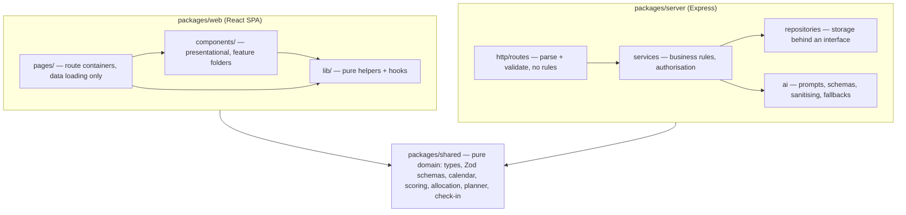
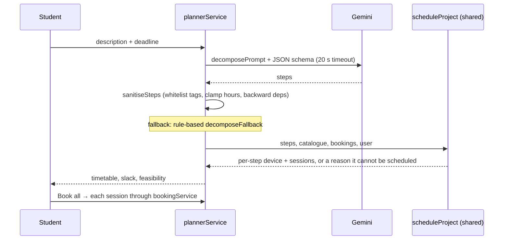

# LabLink architecture

This document explains how the code is organised, how a request flows through it, and why the main design decisions were made. For the product overview, see the [README](../README.md).

## 1. Layers and dependency rules

Rules the code follows:

- **`shared` has no I/O and no framework.** It is pure TypeScript and Zod, so the same validation and rules run in the browser (instant feedback) and on the server (the trust boundary).
- **Routes never contain business rules.** They validate input with shared schemas and call one service method.
- **Services never touch HTTP or a database client directly.** They receive a `BookingRepository`, an `LlmClient` and a `Clock` through the composition root (`server/src/bootstrap.ts` → `services/container.ts`). Tests swap in an in-memory repository, a fake LLM and a fixed clock.
- **Pages hold no layout logic beyond composition.** Each page loads data with TanStack Query hooks (`web/src/lib/queries.ts`) and hands it to feature components (`components/approvals`, `booking`, `bookings`, `dashboard`, `equipment`, `insights`, `map`, `planner`, `updates`). Derivations such as filtering, grouping and validation live in `web/src/lib/*` as pure, unit-tested functions.

## 2. Module map

| Area                 | Files                                                             | Responsibility                                                               |
| -------------------- | ----------------------------------------------------------------- | ---------------------------------------------------------------------------- |
| Scoring              | `shared/src/scoring.ts`                                           | 0–100 priority score (urgency 40, fairness 25, fit 20, waiting 15), ordering |
| Allocation           | `shared/src/allocation.ts`                                        | Conflict detection and fair resolution with reserved alternatives            |
| Project scheduler    | `shared/src/planner.ts`                                           | Topological ordering, device choice, session splitting, capacity, deadline   |
| Check-in             | `shared/src/checkin.ts`                                           | Check-in window, no-show grace, fair-share penalty                           |
| Availability         | `shared/src/availability.ts`, `time.ts`                           | Hour grid, capacity, live status, working days                               |
| AI orchestration     | `server/src/ai/aiService.ts`                                      | Caching, timeouts, fallback selection, health status                         |
| AI contracts         | `server/src/ai/outputSchemas.ts`, `prompts.ts`                    | JSON schemas sent to Gemini, matching validators, prompt builders            |
| AI safety            | `server/src/ai/sanitise.ts`                                       | Tag whitelisting, clamping hours, backward-only dependencies                 |
| Rule-based fallbacks | `server/src/ai/fallbacks.ts`, `fallbackPlanner.ts`, `language.ts` | Keyword and synonym search, template drafts, rule-based project breakdown    |
| Services             | `server/src/services/*Service.ts`                                 | Booking, approvals, check-in sweep, planner, insights, activity feed         |
| Storage              | `server/src/repositories/*`                                       | `BookingRepository` interface; in-memory and Firestore (transactions)        |
| HTTP                 | `server/src/http/*`                                               | Routes, signed sessions, JSON-only CSRF guard, rate limits, error envelope   |

## 3. Request lifecycle: booking a slot

1. **Browser.** `lib/bookingValidation.ts` validates the form with the shared `createBookingSchema` and shows field-level errors instantly.
2. **HTTP.** `POST /api/bookings` passes the JSON-only guard, rate limiter, session verification (HMAC) and schema validation again. The client copy is never trusted.
3. **Service.** `bookingService.create` checks the role, that the device is bookable (lab hours, booking limit, maintenance) and that the student has no clashing booking, then runs inside `repo.transact(...)`:
   - free capacity and no approval needed → `approved` (**confirmed instantly**);
   - approval required → `pending`;
   - other pending requests overlap → `pending`, and the slot joins a **conflict** for fair resolution;
   - already full → `409 SLOT_TAKEN` with alternatives (same device later, or an equivalent device elsewhere).
4. **Response.** The web client invalidates the affected TanStack Query caches and shows the outcome in a toast.

## 4. Fair conflict resolution

1. `detectConflicts` groups overlapping pending requests per device where demand exceeds the free units.
2. `scoreRequest` scores each contender; `comparePriority` orders them deterministically (score, then feasibility, then first-come, then id).
3. `resolveConflict` keeps the top requests that fit, and reassigns the rest to the best alternative, **reserving** each one so no two students get the same fallback.
4. Faculty may ask Gemini to **explain** the plan. The explanation is generated from the engine's output and cannot alter it.
5. **Apply** recomputes the plan on the server inside a transaction and returns `409` if the calendar changed since it was viewed.

## 5. AI project planner

## 6. Check-in and no-show release

- Kiosk codes are `HMAC(secret, equipmentId + date)`, shortened to 6 characters, so they rotate daily and are unique per device.
- The sweep (`checkInService.sweepIfDue`) runs **lazily** on GET requests, throttled to once every 30 seconds per instance, because serverless hosting has no background worker. It is idempotent and runs inside a transaction.
- A session becomes a no-show 15 minutes after its start, or 15 minutes after the time it was granted (`grantedAtIso`) for late approvals and backfills.
- Instant-booking devices are **backfilled** with the best queued request (same scoring engine). Approval-required devices are only released.

## 7. Key decisions

| Decision                                      | Why                                                                                                 |
| --------------------------------------------- | --------------------------------------------------------------------------------------------------- |
| The LLM explains and proposes, never decides  | Allocations must be reproducible, auditable, unit-testable and immune to persuasive request text    |
| Structured output plus a second Zod check     | Gemini's schema mode makes the output well-formed; the validator and sanitiser make it _safe_       |
| Every AI feature has a deterministic fallback | The product works fully without a key or during an outage, and the UI labels the source honestly    |
| Shared package for rules and schemas          | One definition of the rules, so client feedback and server enforcement can never drift apart        |
| Repository interface with transactions        | Capacity checks are race-free on Firestore; tests run against the same interface in memory          |
| Personas instead of login                     | The brief forbids login pages; signed HttpOnly cookies still give real server-side authorisation    |
| Lazy, throttled sweep                         | Vercel has no cron worker on the free tier; reads trigger an idempotent catch-up instead            |
| Hand-built isometric SVG map                  | No map library or tiles, so it costs a few KB, works offline, and every pin is an accessible button |

## 8. API reference

All endpoints are under `/api`, take and return JSON, and use the error envelope `{ "error": { "code", "message" } }`. Mutations require `Content-Type: application/json`.

| Method | Path                             | Role           | Purpose                                                |
| ------ | -------------------------------- | -------------- | ------------------------------------------------------ |
| GET    | `/health`                        | any            | Liveness and Gemini status                             |
| GET    | `/personas`                      | any            | Demo profiles for the profile menu                     |
| GET    | `/session`                       | any            | Current persona (from the signed cookie)               |
| POST   | `/session`                       | any            | Switch persona (`{ personaId }`)                       |
| DELETE | `/session`                       | any            | Clear the session                                      |
| GET    | `/catalog`                       | any            | Departments, labs, equipment (HTTP-cached, ETag)       |
| GET    | `/equipment/status`              | any            | Live state of every device                             |
| GET    | `/equipment/:id`                 | any            | Device detail and hour-by-hour availability (`?from=`) |
| GET    | `/equipment/:id/kiosk`           | faculty, admin | Today's check-in code and sessions                     |
| GET    | `/bookings/mine`                 | any (own)      | The student's bookings                                 |
| POST   | `/bookings`                      | student        | Create a booking (outcome or `409` with alternatives)  |
| POST   | `/bookings/:id/cancel`           | owner          | Cancel a pending or approved booking                   |
| POST   | `/check-in`                      | student        | Check in with the kiosk code                           |
| GET    | `/approvals`                     | faculty, admin | Scored pending requests and conflict plans             |
| POST   | `/approvals/:id/decision`        | faculty, admin | Approve or decline with a note                         |
| POST   | `/conflicts/:conflictId/explain` | faculty, admin | Gemini explanation of the fair allocation              |
| POST   | `/conflicts/:conflictId/apply`   | faculty, admin | Apply the recomputed allocation atomically             |
| POST   | `/planner/plan`                  | student        | Break down and schedule a project                      |
| POST   | `/planner/book`                  | student        | Book every planned session                             |
| POST   | `/ai/search`                     | any            | Natural-language equipment matching                    |
| POST   | `/ai/draft`                      | any            | Draft a booking request from a rough idea              |
| GET    | `/ai/status`                     | any            | Model name and last success or failure                 |
| GET    | `/activity`                      | any (scoped)   | Role-scoped updates feed                               |
| GET    | `/insights/utilisation`          | faculty, admin | Utilisation report                                     |
| GET    | `/insights/recommendations`      | faculty, admin | Gemini optimisation recommendations                    |

## 9. Quality gates

- **ESLint** (`eslint.config.js`): `typescript-eslint` recommended rules, `react-hooks`, `jsx-a11y` strict, and maintainability limits on all source code: cyclomatic complexity ≤ 12, nesting depth ≤ 4, ≤ 300 lines per file, ≤ 100 lines per function, no non-null assertions, no nested ternaries. Only seed data is exempt from the length limits.
- **Coverage thresholds** (Vitest, V8) fail the build if they drop: shared ≥ 90% lines, server ≥ 85%, web ≥ 85%.
- **CI** (`.github/workflows/ci.yml`) runs on every push and pull request: Prettier check → lint → typecheck → tests with coverage → production build → `npm audit` (high severity, runtime dependencies).
